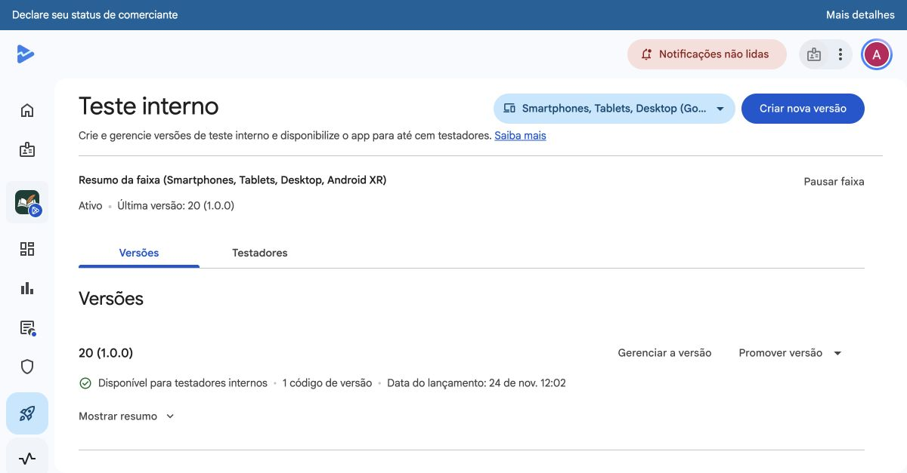

# Publicação Android 20 — 24/11/2026

**Google Play: 20 (1.0.0), disponível para testadores internos**, confirmado às 12:02 em America/Belem. Pacote `com.plataformaesdras.app`. A versão anterior era 19. A faixa fechada e a produção não foram alteradas.

[Versão no Play Console](https://play.google.com/console/u/0/developers/6634974275284956398/app/4974621366811081252/tracks/4701732869010871749/releases/7/details).

## Origem e validação

- Commit do AAB: `99a4191c6618b5057c25c540c08238425841d3d3`, enviado ao GitHub antes do build.
- [Build EAS concluído](https://expo.dev/accounts/alexandrecostagg/projects/plataforma-esdras/builds/74c65d7d-c190-4d91-bb65-11c598d25438), perfil `store-test`, versão remota 20.
- [Pipeline completo aprovado](https://github.com/Alexandrecostagg/Alvo-Church/actions/runs/45414368409): qualidade, autorização, build web, mobile e LP.
- 766 testes em 84 arquivos e typecheck de todos os workspaces aprovados após a atualização.
- Validação online Expo aprovada; exports Android e iOS aprovados; auditoria de dependências sem alertas conhecidos.
- Expo Doctor: 20/21. Aviso restante sobre a pasta nativa iOS versionada. Não há pasta Android versionada; o prebuild Android passou tanto em pasta temporária quanto no EAS.
- Configuração dinâmica passou a receber e preservar o `app.json` pelo mecanismo oficial. Configuração pública antes/depois idêntica.

Foram aplicados nove patches dentro do SDK 57: Expo 57.0.34, build-properties 57.0.24, camera 57.0.6, constants 57.0.25, crypto 57.0.4, image-picker 57.0.22, notifications 57.0.26, secure-store 57.0.4 e splash-screen 57.0.12.

## Artefato

Arquivo local ignorado pelo Git: `apps/mobile/build/esdrasapp-v20.aab`, 61.182.551 bytes.

SHA-256: `da5e40643fa20b5a064c3f2f3f8646453bddf2e0bd58d2eb93a08ffaa564afcf`.

`jarsigner` confirmou `jar verified`. Certificado SHA-256 igual ao da versão anterior:
`97:2E:DE:AD:36:87:1F:9D:DB:8F:18:CF:52:12:01:81:CA:D7:15:60:EB:76:E7:6C:D9:6E:CE:79:3D:D8:BE:C6`.

O verificador Java também emitiu avisos de cadeia autoassinada, ausência de timestamp e leitura por JarInputStream relacionada à ordem das entradas. Foram preservados no log local; o Google Play aceitou o AAB assinado. A integridade ZIP passou. As 15 imagens dos ícones dentro do AAB são idênticas às geradas no prebuild da identidade atual (livro e pena sobre verde).

O Google Play confirmou minSdk 24, targetSdk 36 e quatro ABIs. A comparação com a versão 19 mostrou zero dispositivos que perderam compatibilidade; 12.434 modelos de telefone e 6.603 de tablet compatíveis.

## Tempo e limites

Fila gratuita EAS: aproximadamente 22 minutos, seguida de aproximadamente oito minutos de compilação. Cota consultada: plano Free, 1/30 builds e custo estimado zero. Nenhum plano foi contratado ou alterado.

O teste físico da versão 20 continua pendente, incluindo câmera/Kids, notificações reais, segundo plano e rede instável. Export, build e aceitação da loja não substituem esse teste. Nenhum IPA novo foi gerado.

